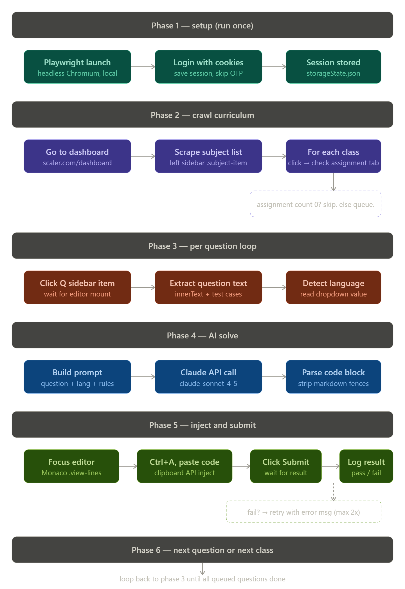

# 🤖 SAAB — Scaler Automation AI Bot

> **Clear your entire assignment backlog automatically.**  
> SAAB is an AI agent that logs into your Scaler dashboard, finds your pending assignments, and works through them: MCQs (including image-based), DevOps terminal labs, and coding problems. **Start with a dry run** (see "First run" below) and read "What has been verified" so you know what to trust.



---

## ✨ What It Solves

| Problem Type | How |
|---|---|
| **BITS Pilani Coursera Quizzes** (Single & Multi-Select) | Autonomous ReAct Loop (Reason ➔ Act ➔ Observe ➔ Self-Correct), Universal AnswerStore (PDF/JSON/TXT/MD), Scramble-Proof Option Matcher, Pre-Submit Auditor, and Auto-Retake Loop |
| **Mission Control Dashboard** | Local Dark Glassmorphism Web UI (`http://localhost:3000`), Drag-and-Drop Answer Key Ingestion, Real-Time SSE Log Streaming, and Live ReAct Inspector |
| **Coding problems** (Java / JavaScript) | Gemini → Groq fallback, 3 retry attempts with compiler feedback loop, direct Monaco API injection |
| **MCQ** (text + image-based) | Gemini Vision for image questions, disk cache so same question is never called twice |
| **DevOps Terminal Labs** (Maxwell container) | AI generates exact bash commands, types them into the xterm terminal via iframe keyboard |
| **VS Code IDE problems** | Extracts Monaco workspace files, AI modifies them, re-injects |

---

## ⚡ Quick Start (3 steps)

### 1. Install
```bash
git clone https://github.com/Ujjwaljain16/SAAB.git
cd SAAB
npm install
npx playwright install chrome
```

### 2. Configure
```bash
cp .env.example .env
# Then edit .env and fill in your keys
```

**Minimum required in `.env`:**
```env
GEMINI_API_KEY=AIzaSy...          # Get free at aistudio.google.com
```

**Recommended (for rate limit fallback):**
```env
GEMINI_API_KEY=AIzaSy...
GROQ_API_KEY=gsk_...              # Get free at console.groq.com
```

### 3. Authenticate (one-time)
```bash
npm run auth
```
A Chrome window will open. Log into Scaler normally (Google OAuth works). Close it when done. Your session is saved and reused automatically.

---

## 🧪 First run (do this, in this order)

1. `npm run dry-run:mcq`: logs in, finds your pending MCQs and prints the answers it WOULD give. Nothing is submitted.
2. `node main.js --only-mcq --max-submissions=3`: a tiny live test. Check on Scaler that those 3 look right.
3. Only then `npm run start:mcq`, and later labs / coding.

Wrong MCQ answers use up the question's attempts (the page shows "N Attempts left"); SAAB makes at most 3 tries per MCQ. `npm start` waits 8 seconds and shows a LIVE-mode banner so you can cancel.

## ✅ What has been verified (be honest with yourself about this)

| Area | Status |
|---|---|
| Google login, session reuse, 3-session-limit page | Tested live |
| Finding pending classes and problems, skipping solved ones | Tested live and in an offline mock site |
| MCQ: solve, submit, 3 tries with rejected options excluded | Tested on a mock site; the live path ran on already-solved questions only |
| DevOps labs: launch, terminal typing, "end previous lab" prompt | Tested live (on already-solved labs) |
| Labs: pressing Run Task and reading the judge's feedback, retries | Run Task clicked once live; feedback reading and retries are tested on a mock only |
| Coding problems (Monaco injection, verdict, retries) | **Not verified live** |
| VS Code IDE problems | **Not verified live** |
| BITS / Coursera (`--bits`) | Not reviewed; not covered by tests |

If something looks wrong, check the `debug/` folder (screenshot + page HTML are saved on failures) and open an issue with them.

## 🎮 Run

```bash
# LIVE: submits real answers for everything it finds (read "First run" first)
npm start

# MCQs only — fastest, zero risk
npm run start:mcq

# Labs only (DevOps terminal labs + VS Code IDE)
npm run start:labs

# Skip terminal labs (if you don't want AI touching DevOps labs)
npm run start:skip-labs

# Dry run — solves but NEVER clicks Submit (safe preview)
npm run dry-run

# Target a specific subject
node main.js --subject=DevOps

# Target a specific class ID
node main.js --class=570714

# Force refresh the curriculum cache
node main.js --refresh-curriculum
```

---

## 🚀 Mission Control Web Dashboard (Phase 2)

SAAB includes a zero-build, developer-grade **Mission Control Web Dashboard** built with native Node.js/Express, Server-Sent Events (SSE), and dark glassmorphism.

```bash
# Launch the Mission Control Web Dashboard
npm run ui
# Or
node ui_server.js
```
Open **`http://localhost:3000`** in your browser.

### Key Dashboard Features
1. **Universal Answer Ingestion Hub (Drag & Drop)**:
   - Drag and drop `.pdf`, `.json`, `.txt`, or `.md` answer keys directly into the browser.
   - Files are automatically saved to `answers/`, parsed via `AnswerStore`, and indexed into memory without restarting the server.
   - Interactive Q&A Browser with search filtering and verified correct answer tags.
2. **Real-Time ReAct Inspector**:
   - Visualizes the 4-stage ReAct loop: **Reason** ➔ **Act** ➔ **Observe** ➔ **Self-Correct**.
   - Displays a live feed of CDP self-corrections as they happen during execution.
3. **Degree & Course Tracking**:
   - Live status cards showing enrolled courses, active assignments, and recorded passing grades (`100%`, `92.5%`, `LOCKED`).
4. **Interactive Control Hub & Live Streaming Terminal**:
   - One-click run triggers: `SUBMIT (Live)` vs `DRY-RUN (Preview)`, course filters, and assignment limits.
   - Real-time terminal log output streamed via Server-Sent Events (SSE).
   - "Stop Execution" button for instant process termination.

---

## 🎓 BITS Pilani (Coursera BSc Computer Science) — Autonomous ReAct Solver

SAAB includes a production-grade autonomous agent tailored specifically for BITS Pilani Coursera degree quizzes, featuring an **Agentic ReAct Loop (Reason ➔ Act ➔ Observe ➔ Self-Correct)**.

### Live Degree Verification Status

| Course | Graded Assignment | Status | Grade | Verification |
|---|---|---|---|---|
| **Software Development Practices** | Graded Quiz (Week 4, 5, 6) | **PASSED** | **100%** | Verified Live |
| **Modern Databases** | Graded Quiz (Week 4, 5, 6) | **PASSED** | **100%** | Retaken Live with AnswerStore |
| **Network Programming & Client-Server** | Graded Quiz (Week 4, 5, 6) | **PASSED** | **92.5%** | Verified Live |
| **Weeks 7 & 8** | Graded Quizzes | **LOCKED** | — | Opens Nov 1 (Early-Halt confirmed) |

### ReAct Loop Architecture

```
           [ Question Loaded ]
                   │
                   ▼
       ┌───────────────────────┐
       │   1. REASON (Tiered)   │
       │ • AnswerStore (PDF/MD)│
       │ • Negative Cache Hint │
       │ • Multi-Provider LLM  │
       └───────────┬───────────┘
                   │
                   ▼
       ┌───────────────────────┐
       │        2. ACT         │
       │ • Select target opt   │
       │ • Uncheck non-target  │
       └───────────┬───────────┘
                   │
                   ▼
       ┌───────────────────────┐
       │      3. OBSERVE       │
       │ • Settle DOM (300ms)  │
       │ • Verify aria-checked │
       └───────────┬───────────┘
                   │
       ┌───────────┴───────────┐
       │ State Mismatch?       │
       ├───────────────────────┤
       │ YES ➔ Self-Correct    │──┐ (Re-enforce via Playwright CDP)
       │ NO  ➔ Next Question   │  │
       └───────────────────────┘  │
                   ▲──────────────┘
                   │
                   ▼
       ┌───────────────────────┐
       │ 4. PRE-SUBMIT AUDIT   │
       │ • 100% Answered?      │
       │ • Targeted Recovery   │
       └───────────┬───────────┘
                   │
                   ▼
       ┌───────────────────────┐
       │ 5. POST-SUBMIT REVIEW │
       │ • Parse Grade (XX.X%) │
       │ • Cache Wrong Options │
       │ • Grade < 80%?        │──┐ (Try Again / Retake)
       │ • ReAct Retake Loop   │◄─┘
       └───────────────────────┘
```

1. **Tiered Reasoning & Universal Answer Ingestion**:
   - **Tier 1 (Ground Truth)**: Loads answer sheets from [`answers/`](./answers) or `--answers=<path>`. Evaluates prompt text similarity and maps answers to live options by content text, making it completely resilient to Coursera option scrambling.
   - **Tier 2 (Negative Feedback Memory)**: Penalizes previously failed options from `.solver-cache/`.
   - **Tier 3 (Multi-Provider Fallback)**: Gemini Vision, Groq, and Grok with structured JSON schemas.
2. **Active State Enforcement & DOM Unchecking**:
   - Emits synthetic events to check target options and **actively unchecks stale non-target options** left behind in previous draft attempts.
3. **Observation & CDP Self-Correction**:
   - Reads settled virtual DOM states (`aria-checked`, `input.checked`).
   - If Coursera's React event listener swallows the click, overrides and enforces selection using native Playwright CDP locators (`page.locator('id=...').check({ force: true })`).
4. **Pre-Submission Completeness Audit Gate**:
   - Audits every question container before signing the Honor Code.
   - Automatically enters a targeted recovery loop for any unanswered questions.
   - **Safety Block**: Aborts submission and saves draft if any question remains unanswered to protect your GPA.
5. **Cross-Attempt Autonomous Retake**:
   - Parses exact decimal grades (`92.5%`, `37.5%`) with negative lookaheads preventing threshold confusion.
   - Scrapes review cards (`0 / 1 point`, `aria-label="Incorrect"`) into `.solver-cache/`.
   - Automatically clicks `Try again` / `Retake assignment` to re-attempt and reach $\ge 80\%$.

### CLI Usage for BITS Coursera

```bash
# Run BITS Coursera degree auto-solver (live submit)
npm run start:bits

# Preview mode (solves and logs questions without submitting)
npm run start:bits:dry-run

# Limit to a single assignment
npm run start:bits:one

# Target a specific course
node main.js --bits --course="modern-databases"

# Pass a specific answer key file
node main.js --bits --answers="answers/modern_databases_week4_5_6.json"

# Target a specific assignment URL directly
node main.js --bits --assignment="https://www.coursera.org/learn/modern-databases/team/IAFhO/graded-quiz-for-week-4-5-and-6"

# Run the full offline E2E test suite (13 parts verified)
npm run test:bits
```

---

## ⚙️ Full `.env` Reference

```env
# ─── Scaler Credentials ─────────────────────────────────────────────────────
# Optional: if set, auth.js auto-logs in. Otherwise log in manually via browser.
SCALER_EMAIL=your@email.com
SCALER_PASS=your_password

# ─── AI Providers (at least one required) ───────────────────────────────────
# Gemini (Google AI Studio — free tier available)
GEMINI_API_KEY=AIzaSy...
# Multiple keys for high-volume round-robin pool:
# GEMINI_API_KEYS=key1,key2,key3
# Model (default: gemini-3-flash-preview)
# GEMINI_MODEL=gemini-3-flash-preview

# Groq (Llama-3.3-70B — free, ultra-fast fallback)
GROQ_API_KEY=gsk_...
GROQ_MODELS=llama-3.3-70b-versatile,qwen/qwen3-32b

# xAI Grok (optional third fallback)
# GROK_API_KEY=xai-...
# GROK_MODEL=grok-beta

# ─── Performance ─────────────────────────────────────────────────────────────
SOLVE_CONCURRENCY=4          # Parallel workers per class (lower = safer)
MAX_OUTPUT_TOKENS=4096       # Max tokens per AI response
API_SPACING_MS=2200          # Min ms between API calls (increase if rate-limited)

# ─── Filtering ────────────────────────────────────────────────────────────────
# TARGET_SUBJECTS=DevOps,Computer Networks   # Comma-separated, blank = all subjects
# SKIP_LABS=true       # Skip Maxwell terminal labs
# ONLY_MCQ=true        # Only solve MCQ problems
```

---

## 🏗️ Architecture

```
SAAB
├── ui/                     ← Mission Control Web Dashboard frontend (HTML5, Vanilla CSS, JS)
│   ├── index.html          ← Glassmorphic dashboard (BITS, Scaler, Ingestion Hub, Terminal)
│   ├── styles.css          ← Dark theme design system (Inter font, micro-animations, glass cards)
│   └── app.js              ← Client controller (SSE streaming, drag-and-drop ingestion, tabs)
├── ui_server.js            ← Express backend server with SSE streaming, file upload, & runner
├── answer_indexer.js       ← Universal AnswerStore: PDF/JSON/TXT parser with scramble-proof matching
├── answers/                ← Answer key storage directory (drop PDFs, JSON, or text files here)
├── bits_main.js            ← BITS Coursera degree runner & early-halt boundary controller
├── bits_handler.js         ← BITS quiz solver: ReAct enforce/observe loop, audit gate, & auto-retake
├── bits_crawler.js         ← BITS degree dashboard & module outline crawler
├── bits_auth.js            ← Coursera authentication helper
├── bits-run-state.json     ← Persistent degree completion state & verified grades
├── test_bits_dom.js        ← 13-part offline E2E test suite for BITS Coursera
├── main.js                 ← Scaler orchestrator: crawls queue, spawns worker pool, checkpoints
├── crawler.js              ← Discovers all pending assignments from Scaler dashboard
├── solver.js               ← AI engine: Gemini Vision + Groq fallback, caching, retry loop
├── injector.js             ← Monaco editor injection + verdict detection for coding problems
├── mcq_handler.js          ← MCQ scraper (text + screenshot), answer injector
├── lab_handler.js          ← Maxwell terminal lab: Launch → AI commands → xterm type → Submit
├── workspace_manager.js    ← VS Code IDE: Monaco file extraction → AI solve → re-inject
├── code_utils.js           ← Pure helpers for cleaning/validating LLM output (unit-tested)
├── lab_guard.js            ← Refuses destructive/unsafe AI-generated lab shell commands
├── config.js               ← All CSS selectors (update here if Scaler changes DOM)
└── auth.js                 ← One-time login session creator
```

**AI Waterfall per problem:**
```
Gemini (key 1) → Gemini (key 2..N) → Groq (model 1) → Groq (model 2) → Grok → fail
         ↓ on 429: exponential backoff + key rotation
         ↓ on empty output: isRetryableServerError → retry with backoff
```

---

## 🛡️ Reliability Features

- **Run state checkpoint** — resumes exactly where it left off after a crash or Ctrl+C
- **Short curriculum cache** — 2 min by default (`CURRICULUM_CACHE_TTL_MS` to change, `--refresh-curriculum` to force)
- **Verified-only solution cache** — SHA-256 keyed; an answer is cached only after Scaler confirms it passed, and evicted if it fails (wrong MCQ options are remembered so they aren't re-submitted)
- **No guessed answers** — if no provider returns a valid MCQ answer nothing is submitted
- **Lab command guard** — destructive/exfiltrating commands from the model are refused
- **Ctrl+C** — first press saves state and stops cleanly, second press force-quits; fatal errors exit non-zero
- **Session auto-recovery** — detects `/login` redirect and re-authenticates mid-run
- **SolveBot purge** — removes Scaler's floating AI widget before every interaction
- **Proceed modal handling** — automatically confirms confirmation dialogs
- **SIGINT/SIGTERM** — Ctrl+C saves state cleanly before exit

---

## 📊 Run Output Example

```
============================================================
Processing class: https://www.scaler.com/academy/.../class/570714
Pending: Assignment 2/7
Subject: DevOps
============================================================
Found 7 assignment problem(s). Initiating Page Pool workers...

  [Worker 0] Detected problem type: mcq for Q1 - Linux Basics
  [Worker 0] [CACHE HIT] MCQ Option 3
  [Worker 0] ✓ MCQ Passed: Q1 - Linux Basics

  [Worker 1] Detected problem type: lab for Q4 - File Permissions Lab
  [Lab Solver] Maxwell container ready in 18s!
  [Lab Solver] Generated 5 commands.
  [Lab Solver] ✓ Lab is fully SOLVED!

=== Run Summary ===
Solved: 6   Failed: 0   Skipped: 1
Cache hits: 4, misses: 3
Elapsed: 142s
```

---

## ⚠️ Important Notes

- **Never commit `.env` or `session.json`** — they contain your password and active session cookies
- **`temp_chrome_profile/`** is gitignored — it holds your Chrome login state
- Reduce `SOLVE_CONCURRENCY` to `1` if you hit "too many requests" errors on Scaler's side
- On first run, let the crawler finish fully — it builds `curriculum-cache.json` which speeds up repeat runs
- Run `npm test` for the unit tests

---

## 🤝 Contributing

Problems, edge cases, new problem types — PRs welcome. The selector config lives entirely in [`config.js`](./config.js) so DOM changes are a one-line fix.

---

## 🚦 Rate limits and Gemini key pooling

**Pooling.** Put several keys in `GEMINI_API_KEYS=key1,key2,key3`. Work goes to the least-loaded usable key (not always key 1), a key that hits its **daily** quota is retired for the day, and Groq/Grok are the fallbacks.
Google applies limits **per project, not per API key**, so extra keys only add capacity when they belong to different projects. (The rate-limit page says nothing either way about using several projects; check Google's terms before relying on that.)

**Staying under the limits.** Every request passes through a per-key limiter (`rate_limiter.js`):
- a rolling **requests-per-minute** cap (`GEMINI_RPM`, default 10) and a minimum gap (`API_SPACING_MS`)
- an optional **requests-per-day** budget (`GEMINI_RPD`) that is persisted in `.quota/` (key hashes only, never keys), so a second run the same day knows what the first spent. The day rolls over at midnight **Pacific** time, like Google's quota
- if a 429 still happens, the whole lane pauses for the provider's retry delay, the allowed rate is halved and creeps back up after quiet minutes. Per-minute limits never retire a key; only a genuine per-day limit does
- when every provider is out for the day the run stops cleanly and resumes from its checkpoint

**What can't be guaranteed.** Google's free-tier numbers are per model, unpublished on the docs page, and "not guaranteed", so there is no universally safe default: read them in AI Studio and set `GEMINI_RPM` / `GEMINI_RPD`. Tokens-per-minute is not tracked (image questions cost more), and anything else using the same project (a browser tab in AI Studio, another script) spends the same quota.

---

## 🎯 What gets solved (and what never does)

- **Only assignments.** The "Additional Problems" (homework) section of a class is **not** solved by default; its links are ignored.
- **Never an already-solved problem.** If the problems table, the question dock or the problem page says *Solved* (status tag only, never free text in the title), it is skipped; the state is re-checked right before every AI call and every submit.
- **MCQs:** up to **3 tries** (`MCQ_MAX_TRIES`). Every wrong answer is remembered and excluded from the next try; after that the question is left alone, including on later runs. A verdict is read from what *changed* after the click (Solved, or the attempts counter dropping), never from a badge that was already there.
- **Labs:** if Scaler warns that running again would reset completed tasks, SAAB cancels and stops instead of confirming.

### Model pool (recommended)

On the free tier the daily quota is **per model**. The default model used to be `gemini-2.5-flash` (20 requests/day) which a single class can exhaust.
Set `GEMINI_MODELS=gemini-3.1-flash-lite,gemini-3.5-flash-lite,gemini-2.5-flash` to get ~1000 requests/day per key: the first model is used while it has
capacity (15/min, 500/day), then the next one takes over, and the daily/per-minute budgets of every (model, key) pair are tracked separately and remembered
across runs. Image questions only go to vision-capable (Gemini) models, and Gemma models are never sent JSON mode (they reject it).
`GEMINI_LIMITS=model=rpm/rpd,...` teaches SAAB the limits of a model it does not know.
